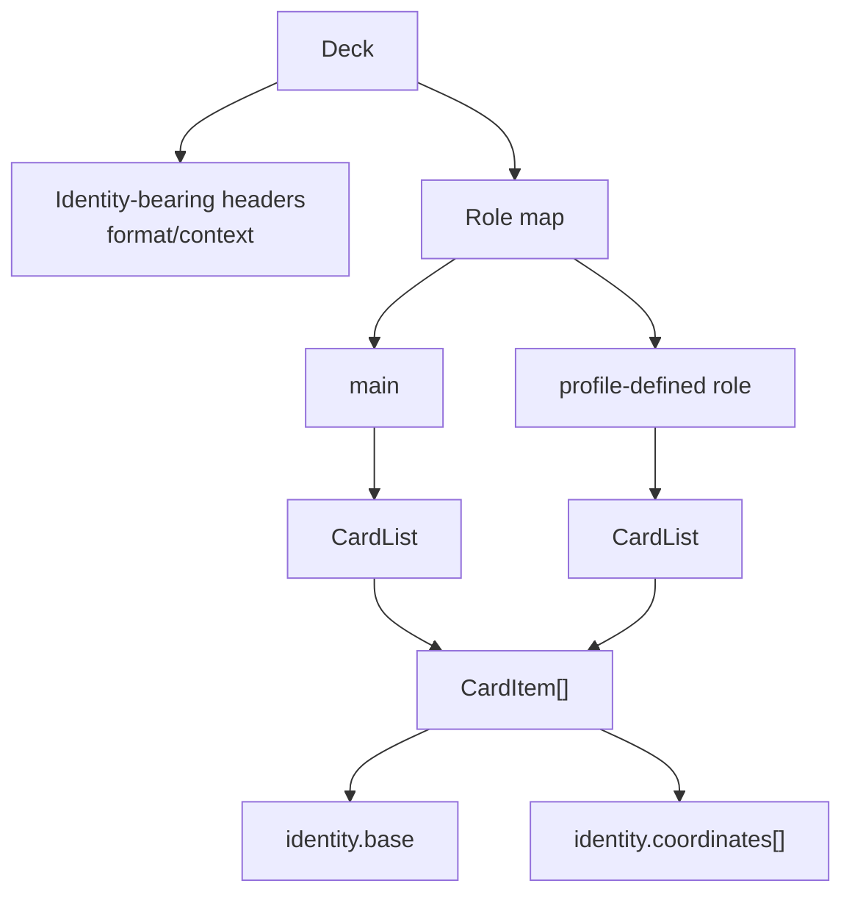
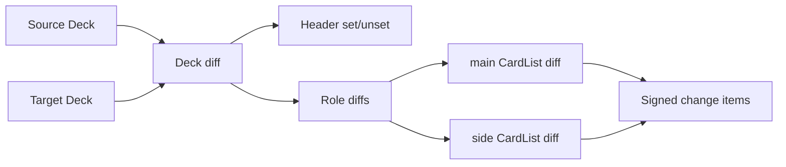
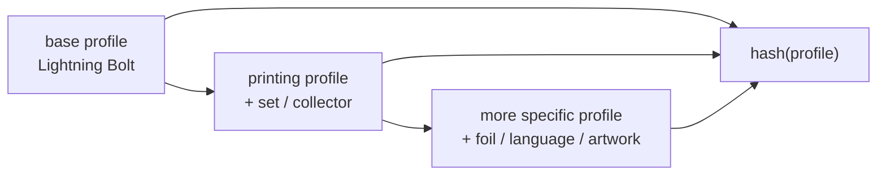

  

    
     
    <strong>cardhash</strong>
     
    an open deck standard
  

  

    
    
    
    
    
  

Cardhash is a reference implementation and proposal workspace for a standard representation of trading card game decklist graphs. The standard is intended to represent decklists, diffs between lists, and the graph of their evolution.

## Objective

Cardhash aims to define a language-independent standard for representing trading card game Decks, role-associated CardLists, card identity, printing and treatment coordinates, changes between Deck states, and Deck evolution relationships. The project prioritizes stable identity, deterministic comparison, human-readable exchange, and implementation boundaries that can support multiple games and future language ports.

## High-Level Intent

The standard separates concerns that are often conflated by deckbuilding tools:

- Card identity is distinct from printing, treatment, catalog enrichment, legality, presentation, and provenance.
- A Deck is composed of named role-associated CardLists rather than being treated as one flat card pile.
- CardList comparison is the primitive diff operation; Deck diffs compose those role-scoped results and add Deck-level header changes.
- Structural identity is the baseline. Registered, versioned profiles can add progressively specific identity coordinates such as set, collector number, or foil state.
- Intended format/context may contribute to Deck identity, while legality is calculated separately by policy or game engines.
- Structured interchange is canonical in principle, with a strict human-readable rendering and permissive adapters for common vendor formats.

## Expected Outcomes

The project is intended to produce:

- A stable, extensible ontology for Decks, CardLists, card identity coordinates, headers, changesets, and graph relations.
- Deterministic hashes and changesets that can be reproduced across implementations.
- Lossless structured exchange with an editable text representation for people and tools.
- Composable Deck diffs that can describe structural changes, treatment-specific changes, format changes, and role-scoped operations.
- Conformance examples and test vectors suitable for future Go, TypeScript, PHP, and other implementations.
- A graph model capable of representing direct derivation without confusing provenance with calculated similarity.

## Format Overview

The intended Deck shape is an explicit header plus a map of canonical roles. Each role owns an unordered CardList, and each CardItem carries a base identity with optional progressively specific coordinates.

Deck diffs are composed from role-scoped CardList diffs and explicit header operations. Omitted roles and headers mean no change.

Hash profiles select how much identity specificity participates in a calculation while preserving the base card identity.

The evolving proposal is documented in [`agents/20261117_01_tcg-decklist-graph-standard.md`](agents/20261117_01_tcg-decklist-graph-standard.md).
The current provisional decisions from interactive review are recorded in [`agents/20261118_03_interactive-design-decisions.md`](agents/20261118_03_interactive-design-decisions.md).

## Status

This project is at the proposal, documentation, and v0 reference-implementation stage. Names, structures, hashing rules, graph relations, and card metadata conventions are provisional until explicitly adopted. The current Go baseline lives under [`implementation/golang/v0`](implementation/golang/v0).

## Implementation

The current Go baseline is intentionally versioned as `v0` so future reference implementations can evolve without silently changing its behavior.

The v0 module is divided into three packages under `implementation/golang/v0`:

- `standard` contains shared ontology and contracts.
- `engine` contains generic hashing, changeset, replay, profiles, and validation machinery.
- `mtg` contains Magic-specific identity, format, treatment, and rule composition.

The v0 implementation is executable design guidance, not finalized conformance. Its hashing and comparison APIs retain the earlier structural/treatment split while the evolving standard moves toward parameterized `hash(profile)`, layered identity coordinates, and first-class CardList comparison.

## Repository Checks

Run `make check` to perform repository-independent checks available before a language-specific implementation exists.

## Licensing

The project is intended to use the MIT License. A formal `LICENSE` file will be added when that licensing decision is finalized.
