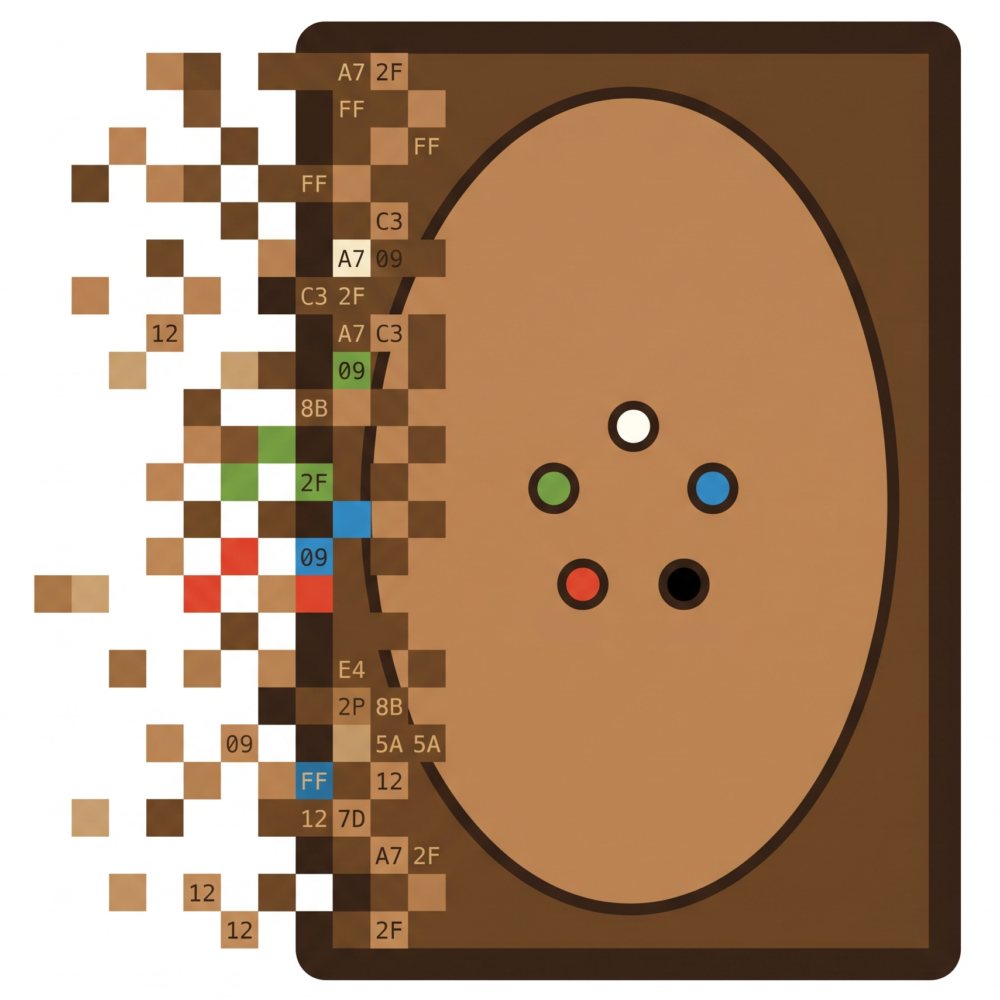

<table align="center" width="100%" border="0">
  <tr>
    <td align="center" width="100%">
      
       
      <strong>cardhash</strong>
       
      an open deck standard
    </td>
  </tr>
  <tr>
    <td align="center">
      
      
      
      
      
    </td>
  </tr>
</table>

# Cardhash

Cardhash is a reference implementation and proposal workspace for a standard representation of trading card game decklist graphs. The standard is intended to represent decklists, diffs between lists, and the graph of their evolution.

The evolving proposal is documented in [`agents/20261117_01_tcg-decklist-graph-standard.md`](agents/20261117_01_tcg-decklist-graph-standard.md).
The current provisional decisions from interactive review are recorded in [`agents/20261118_03_interactive-design-decisions.md`](agents/20261118_03_interactive-design-decisions.md).

## Status

This project is at the proposal, documentation, and v0 reference-implementation stage. Names, structures, hashing rules, graph relations, and card metadata conventions are provisional until explicitly adopted. The current Go baseline lives under [`implementation/golang/v0`](implementation/golang/v0).

## Implementation

The current Go baseline is intentionally versioned as `v0` so future reference implementations can evolve without silently changing its behavior.

## Repository Checks

Run `make check` to perform repository-independent checks available before a language-specific implementation exists.

## Licensing

The project is intended to use the MIT License. A formal `LICENSE` file will be added when that licensing decision is finalized.
