# Go Reference Implementation Guide

This document explains the v0 Go implementation of the TCG Decklist Graph Standard. The governing proposal is [`../../../agents/20261117_01_tcg-decklist-graph-standard.md`](../../../agents/20261117_01_tcg-decklist-graph-standard.md); the implementation is intentionally executable guidance for that proposal, not a claim that every provisional design question has been resolved.

## Purpose And Status

The implementation provides a language-level model for decks, role-bearing card lists, card items, card references, treatments, hashes, changesets, changeset application, game profiles, and legality diagnostics.

The implementation MUST preserve the proposal's primary boundary: card-content identity is separate from metadata, presentation, catalog enrichment, legality, and provenance.

The implementation SHOULD be treated as a v0 reference baseline for future TypeScript, PHP, or other language implementations. It MUST NOT be treated as a finalized wire protocol or official MTG rules engine. Future reference iterations SHOULD use separate namespaces rather than silently changing v0 behavior.

The v0 implementation is organized into three Go packages under `implementation/golang/v0`: `standard` for shared ontology and contracts, `engine` for reusable algorithms and validation machinery, and `mtg` for Magic-specific profile and rule composition. Dependencies flow from `mtg` to `engine` to `standard`; `standard` MUST NOT import either implementation package.

## Package Map

| Package/file | Responsibility | Standard boundary |
| --- | --- | --- |
| `v0/standard/model.go` | Core entities, profile interfaces, structural validation, role normalization | Deck, CardList, CardItem, CardRef, CardMeta, Treatment |
| `v0/standard/changes.go`, `v0/standard/diagnostic.go` | Shared changeset and diagnostic ontology | ChangeSet, ChangeItem, scopes, validation result boundary |
| `v0/standard/constants.go` | Core role constants | Reserved `main` role |
| `v0/engine/hash.go` | Canonical projections and SHA-256 identity calculation | v0 StructureHash/TreatmentHash behavior |
| `v0/standard/changes.go`, `v0/engine/changeset.go` | Shared changeset ontology and generic diff algorithms | ChangeSet, ChangeItem, diff scope, changeset hashes |
| `v0/engine/apply.go` | Changeset replay with treatment omission policy | v0 clear/preserve application semantics |
| `v0/engine/profile.go` | Generic and configurable profile implementations | Game-independent profile extension point |
| `v0/engine/rules.go` | Generic validation context, rule handlers, and validator pipeline | External legality and rule-profile evaluation |
| `v0/engine/constants.go`, `v0/engine/doc.go` | Engine policy constants and package boundary declaration | Go implementation policy |
| `v0/mtg/mtg.go`, `v0/mtg/constants.go` | MTG profile, format presets, and handler composition | MTG identity and catalog-independent legality baseline |
| `v0/mtg/doc.go` | MTG package boundary declaration | Magic-specific namespace |
| `*_test.go` | Requirement and adversarial behavior coverage | Executable conformance guidance |

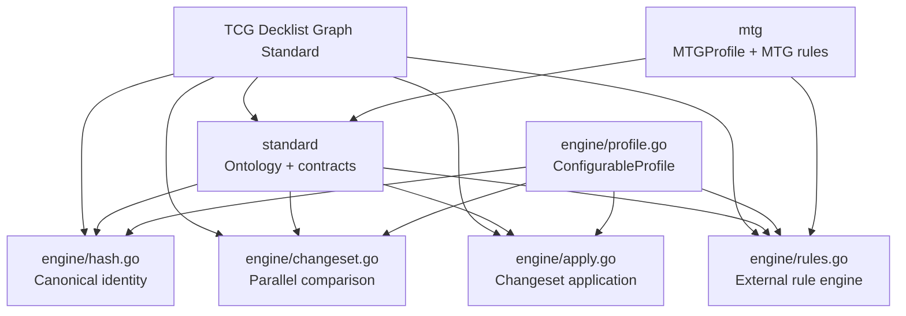

## Core Domain Model

`Deck` is the explicit top-level container. It contains one or more `CardList` values and may carry a name and direct source hash references. The name and source references are metadata and MUST NOT affect either content hash.

`CardList` represents one semantic role such as the core `main` role or a profile-defined sideboard role. Its role participates in the containing deck hash, but its card-content hash does not include the role.

`CardItem` stores a positive quantity and one normalized-by-profile `CardRef`. Optional `Treatment` describes a printing or physical realization. Optional `CardMeta` carries display and catalog enrichment without becoming identity.

`Treatment` is an open map at the model boundary. A profile projects the map into recognized hash-significant fields. This allows unknown data to survive in memory while preventing an implementation from claiming that every future field already has standardized identity semantics.

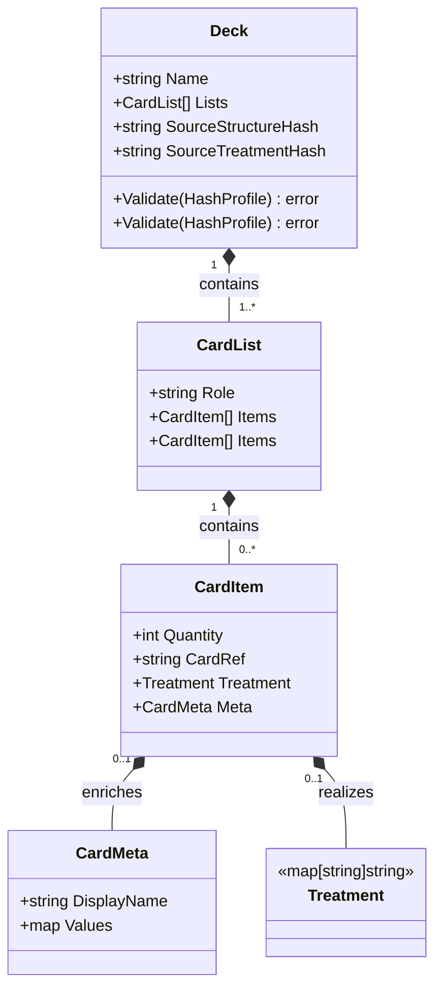

### Structural Validation

`Deck.Validate` checks only representation-level invariants. It requires at least one list, rejects duplicate canonical roles, rejects non-positive quantities, delegates card-reference normalization to the active profile, and delegates treatment validation to the active profile.

`Deck.Validate` deliberately does not check format legality. A deck may be illegal, unresolved, or incomplete from a catalog perspective and still remain representable, hashable, and comparable.

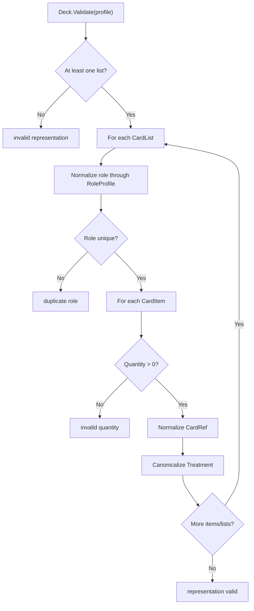

## Profile Interfaces

`HashProfile` is the minimum identity contract. It defines card-reference normalization, treatment projection, and treatment-profile identity. Existing callers that only need hashing can implement this interface without adopting the validation engine.

`RoleProfile` adds profile-owned role normalization. The core falls back to generic lowercase whitespace normalization when a legacy `HashProfile` does not implement `RoleProfile`.

`GameProfile` combines `HashProfile`, `RoleProfile`, and `GameID`. The rule engine requires `GameProfile` because handlers must share a game namespace and consistent role/card normalization.

`engine.GenericProfile` is the fallback profile for profile-independent work. `engine.ConfigurableProfile` demonstrates a non-MTG profile that can declare a game namespace, a versioned treatment namespace, and hash-significant treatment fields without writing a game-specific engine.

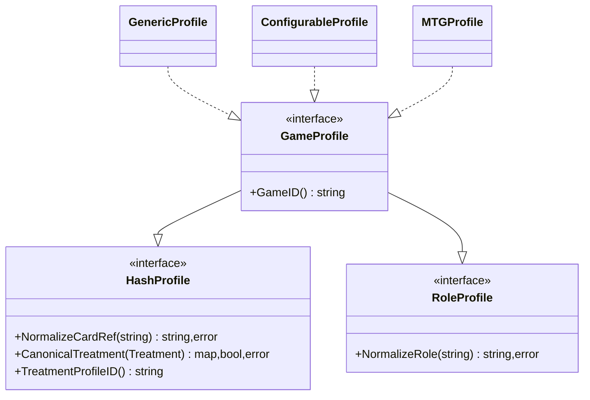

### Profile Boundary

Profiles own identity rules that vary by game. They MUST NOT perform legality validation as a side effect of card-reference normalization or treatment canonicalization.

Profiles MAY reject malformed field names, but unknown treatment fields are provisionally omitted from the hash projection. This matches the current proposal's round-trip direction while leaving stronger extension registries and catalog synchronization for future work.

Profiles SHOULD use immutable, namespaced treatment IDs. The Go baseline does not enforce a registry or semantic version grammar; it only carries the profile-provided value into treatment hashing.

## Constants And Namespaces

`standard/constants.go`, `engine/constants.go`, and `mtg/constants.go` separate core ontology values, Go engine values, and MTG-specific values.

Core constants include `RoleMain` and the shared changeset scopes. Engine constants include fallback profile IDs, diagnostic codes, handler names, and hash domains. These values are implementation policy and therefore live in `engine` rather than `standard`.

MTG constants include `mtg.GameID`, `mtg.RoleSideboard`, `mtg.RoleCommanders`, MTG format identifiers, MTG diagnostic codes, and MTG treatment field names. These values MUST remain scoped to the `mtg` package so a future game cannot accidentally inherit Magic-specific semantics.

The Go JSON struct tags remain string literals because Go requires tags to be compile-time struct metadata rather than expressions. They are wire field names, not reusable domain values in the same sense as roles, hash domains, or diagnostic codes.

## Hashing Pipeline

The v0 implementation exposes separate structural and treatment hash results, but this is a v0 compatibility shape rather than the settled standard API. The standard direction is `hash(profile)`, with `StructureHash` as the baseline alias and more-specific coordinate profiles as selectable views.

The v0 structural path uses quantity and normalized `CardRef`, merging differently treated copies of the same reference into one structural quantity. The v0 treatment path uses profile-recognized treatment buckets and falls back to the structural result when no recognized treatment exists. Future versions MUST replace this binary behavior with registered, composable coordinate profiles.

The settled standard direction includes identity-bearing Deck headers, initially format/context, in Deck hash inputs. v0 currently excludes Deck headers from its content hashes and MUST therefore not be described as implementing the final header-aware hash contract. Metadata, source hashes, legality diagnostics, and presentation order remain excluded from v0 hashes.

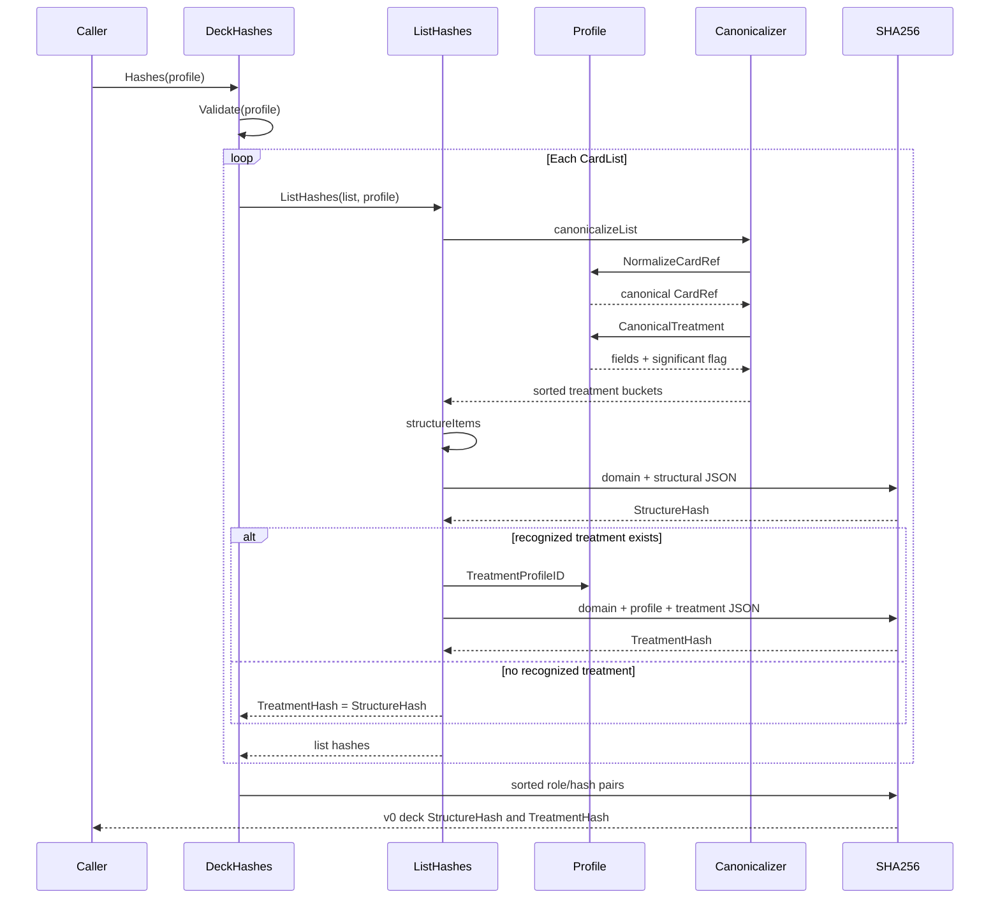

### Canonicalization Steps

The v0 list canonicalizer performs the following domain steps:

- It rejects non-positive quantities before any hash is emitted.
- It normalizes each `CardRef` through the active profile.
- It projects treatment fields through the active profile.
- It combines repeated equivalent `(CardRef, Treatment)` buckets.
- It sorts treatment buckets by canonical reference and treatment JSON.
- It separately aggregates all buckets by `CardRef` for structure scope.
- It serializes a fixed v0 domain/value envelope as UTF-8 JSON and hashes it with SHA-256.

The v0 baseline uses Go `encoding/json` as its canonical JSON mechanism. Go deterministically sorts map keys during JSON encoding, but the settled standard direction selects RFC 8785 JCS and requires explicit profile, domain, algorithm, and canonicalization metadata.

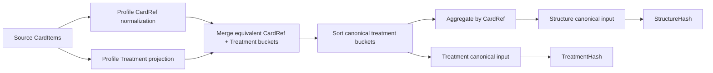

## Deck Hash Composition

Each list is hashed without its role. `DeckHashes` then creates role/hash pairs and sorts them by canonical role before hashing. In the settled standard, the Deck hash also includes the canonical identity-bearing header registry, initially format/context. v0 does not yet include those headers.

The v0 structural Deck hash contains role plus list `StructureHash`. The v0 treatment Deck hash contains role plus list `TreatmentHash`. Future versions MUST express this as `Deck.hash(profile)` and include the selected profile/domain envelope and identity-bearing headers.

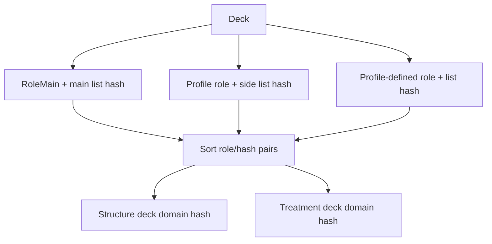

## Comparison And Changesets

The v0 `Compare` validates both Decks, computes endpoint hashes, and produces both a `StructureChangeSet` and a `TreatmentChangeSet`. This is retained as a v0 compatibility API. The settled standard makes `CardList` comparison primitive and defines Deck comparison as composition of role-associated list results plus explicit header operations under a caller-selected profile.

The v0 structural diff flattens each Deck by `(role, CardRef)` and ignores treatment. The v0 treatment diff flattens by `(role, CardRef, canonical treatment)`. The target-minus-source quantity determines the sign. Future versions MUST expose role-scoped results as the canonical Deck diff and may provide the flattened v0 view as a derived representation.

`normalizeChangeItems` accepts denormalized input, combines equal signed buckets, discards net-zero items, canonicalizes profile values, and sorts the result. A malformed reference or treatment field is returned as an error rather than silently omitted.

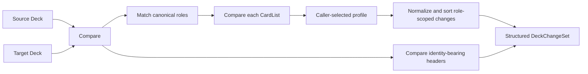

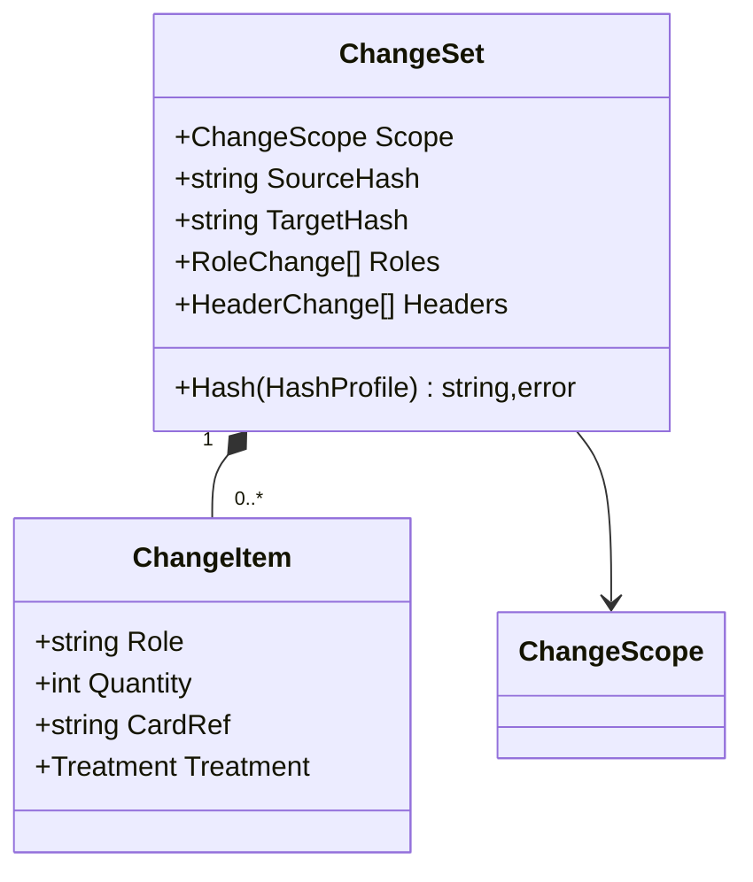

Changeset hashes exclude source and target references. This follows the proposal's distinction between semantic change identity and the Deck pair in which a change was observed. v0 uses flattened role-bearing items; the settled standard requires the canonical profile and domain to identify the normalized structured result.

### Comparison Composition Direction

The current Go baseline exposes `Compare` at the `Deck` level, but the standard direction is to make `CardList` comparison the primitive operation and define deck comparison as composition over normalized roles. The implementation SHOULD evolve toward a reusable list comparison function with an explicit projection or equivalent options:

- The baseline projection groups quantities by normalized base identity coordinates.
- A more specific projection groups quantities by normalized base identity plus selected coordinate values.
- The deck operation matches canonical roles, delegates matched list pairs to the list operation, combines role-scoped results deterministically, and emits header set/unset operations.
- Role creation, removal, and renaming are not card-bucket changes and require separate operations or remain reported as representation gaps.

This direction is intentionally a contract clarification rather than a claim that the current API is final. The existing flattened deck changesets remain useful executable guidance, but future APIs MUST make clear whether flattening is canonical or a derived view of nested role-scoped results.

The implementation SHOULD also separate comparison compatibility diagnostics from changeset application errors. A list comparison MAY remain catalog-independent and MAY compare unresolved references when the active profile can normalize them, but it MUST reject or diagnose incompatible profile, ordering, or treatment contexts deterministically.

## Changeset Application

`ApplyChangeSet` is a v0 API. It applies treatment changes by v0 treatment bucket and structural changes by normalized CardRef.

The v0 treatment scope rejects under-removal from a specific bucket. Structural scope can create a role for positive additions but cannot fully represent header operations. The settled default is best-effort application with diagnostics; strict underflow and source-hash validation are configurable policies.

For structural changes, `ClearTreatment` removes treatment from all resulting items. `PreserveTreatment` retains surviving source treatment buckets and leaves new additions untreated. Neither v0 policy invents a treatment for a newly added card. A future engine MAY resolve unspecified coordinates during application, but canonical diff calculation MUST use exact selected-coordinate buckets.

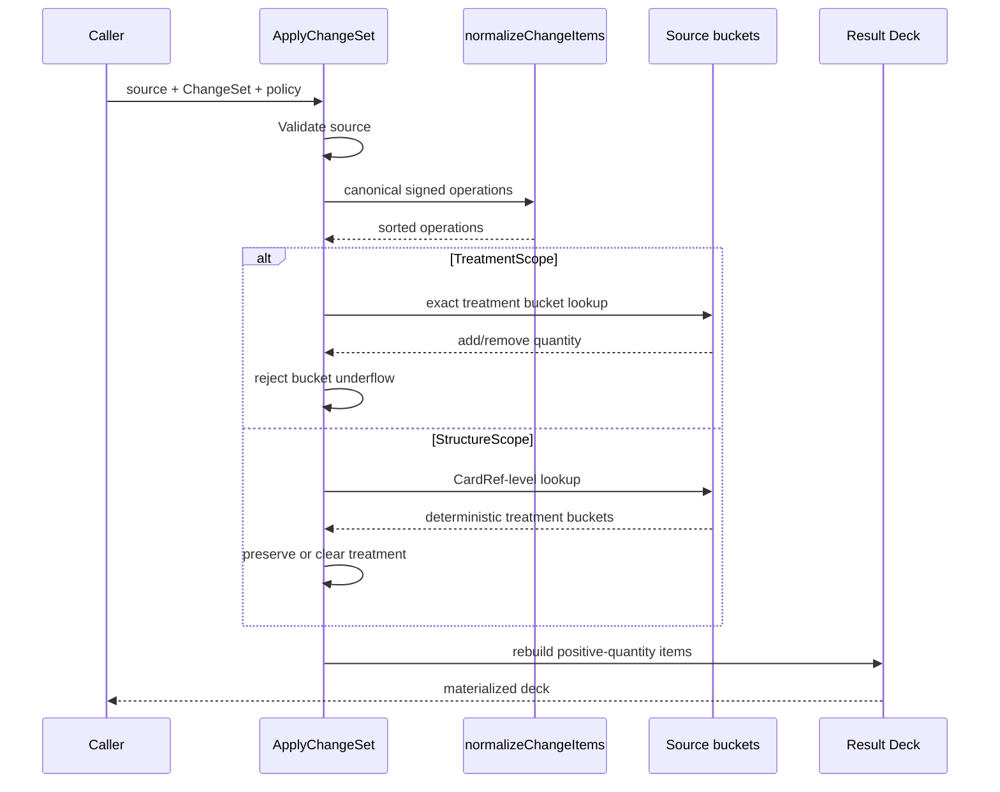

## Generic Validation Engine

The validation engine separates representation validation from rule validation.

`Validator.Validate` first calls `Deck.Validate`. If the representation is invalid, it returns one structural diagnostic and does not invoke handlers. If representation is valid, it creates a `ValidationContext` and invokes each configured `RuleHandler` in order.

Handlers report diagnostics rather than booleans. This permits a single validation pass to report multiple independent violations and keeps the engine independent of any specific game's legality vocabulary.

The reusable handlers are:

- `RequiredRoleRule` checks that a semantic role exists.
- `CardCountRule` checks minimum and maximum quantity for one role.
- `CombinedCardCountRule` checks an exact total over multiple roles.
- `CopyLimitRule` aggregates normalized card references and supports profile-specific exemptions.

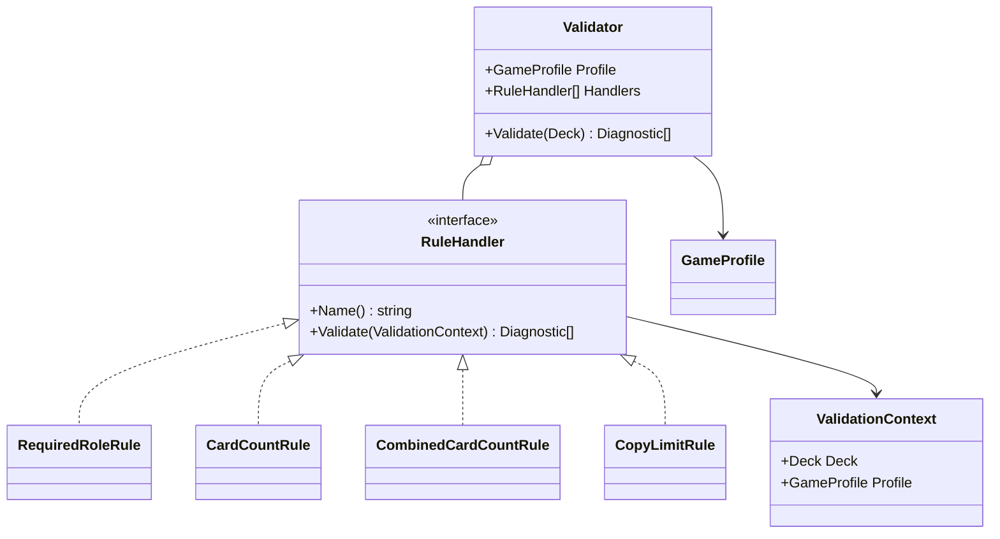

## MTG Engine Composition

`MTGProfile` implements Magic-specific CardRef normalization, NFC normalization, delimiter handling, recognized treatment fields, MTG game ID, and role normalization.

`ValidateMTG` does not contain a separate imperative validation algorithm anymore. It translates `MTGRules` into generic handlers and executes them through `NewValidator`.

The MTG composition uses `RequiredRoleRule` for `main`, `CardCountRule` for main and sideboard bounds, `CardCountRule` for commander count, `CombinedCardCountRule` for the 100-card Commander total, and `CopyLimitRule` for four-copy or singleton rules.

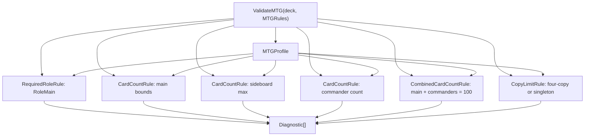

The built-in `ConstructedRules` and `CommanderRules` are deliberately count-rule baselines. They do not resolve Oracle text, set legality, banned lists, color identity, commander eligibility, or every basic-land exception.

## Non-MTG Extension Flow

A non-MTG implementation can construct `ConfigurableProfile` when its card identity is a normalized human-readable name and its treatment vocabulary is known. It can then compose generic handlers directly or create a game-specific handler that implements `RuleHandler`.

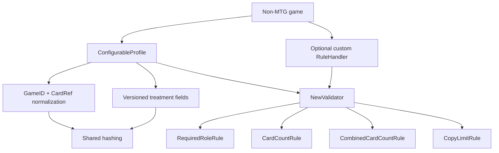

A game with non-human-readable or non-unique names SHOULD implement a custom `GameProfile` rather than relying on `ConfigurableProfile`. A game with catalog-backed legality MAY add a catalog service behind a custom `RuleHandler`, but catalog lookup MUST NOT become an implicit prerequisite for hashing or comparison.

## Constant Scoping

The implementation uses package-level constants for values that are part of the shared protocol contract, engine-level constants for Go algorithm policy, and constants in the `mtg` package for Magic-specific values.

Shared values include `standard.RoleMain`, `standard.StructureScope`, and `standard.TreatmentScope`. Engine values include fallback profile IDs, hash domains, diagnostic codes, and generic rule-handler names.

MTG-specific values include `mtg.RoleSideboard`, `mtg.RoleCommanders`, `mtg.FormatConstructed`, `mtg.FormatCommander`, MTG diagnostic codes, and MTG treatment field names.

Future engines SHOULD follow the same rule: shared values belong in the core namespace; engine-specific roles, format IDs, treatment fields, and diagnostics MUST carry an engine-specific prefix or type scope.

## Standard Alignment And Deliberate Differences

| Proposal recommendation | Go baseline behavior | Difference or limitation |
| --- | --- | --- |
| Explicit Deck and CardList structure | `Deck` contains `[]CardList`; each list has a `Role` | Aligned |
| Core reserves `main` only | `RoleMain` is the only core role constant | Aligned; MTG adds scoped roles |
| Legality is external to content identity | `Validator` and `ValidateMTG` return diagnostics outside hashes | Aligned |
| CardRef is profile-defined | `HashProfile` and `GameProfile` own normalization | Aligned |
| MTG uses NFC and lowercase comparison | `MTGProfile` uses `golang.org/x/text/unicode/norm` and lowercase output | Baseline does not yet pin a Unicode version in a wire-level profile registry |
| Hash profiles are registered and composable | v0 `HashProfile` provides local normalization and treatment projection | v0 has no registered coordinate registry or profile composition |
| StructureHash ignores treatment | `structureItems` aggregates all treatment buckets by CardRef | Aligned |
| TreatmentHash includes present recognized treatment | `canonicalizeList` keeps treatment buckets and an untreated bucket when active | Explicit redaction, absent, and unknown-field states are not yet distinct model types |
| Canonical JSON and SHA-256 | `encoding/json` plus SHA-256 with v0 domain envelopes | v0 is not yet RFC 8785 JCS-compatible |
| Deck hashes use role/hash pairs and identity headers | `DeckHashes` sorts canonical role/hash pairs | v0 does not yet include the identity-bearing format/context header |
| Profile-scoped comparison | `Compare` returns v0 structural and treatment results | v0 is Deck-first and does not expose the canonical role-scoped profile result |
| Signed ChangeItems are positive/negative and non-zero | `normalizeChangeItems` combines, cancels, sorts, and removes zeros | Aligned for card buckets |
| Changeset application supports omission policy | `ApplyChangeSet` supports clear and preserve policies | v0 does not yet expose the settled best-effort diagnostics and header operations |
| Single-source derivation metadata | `Deck` stores source hashes | No graph node/edge storage or cycle policy exists yet |
| Unknown extensions should round-trip | `Treatment` remains open at the model boundary | The baseline profile does not provide a general serialized extension container |
| Total comparison does not require catalog resolution | Hashing and `Compare` use profile normalization only | Aligned |

## Known Representation Gaps

The implementation MUST NOT be described as complete standard conformance because the following proposal areas remain deliberately provisional or absent:

- There is no transport schema, media type, capability negotiation, or canonical wire encoding.
- There is no graph store for immutable revisions, explicit edges, branches, or future merges.
- There are no role-level changes for role creation, removal, or renaming.
- `Compare` is currently deck-first; a first-class `CardList` comparison projection and canonical role-scoped Deck result remain to be implemented.
- There is no registered coordinate registry, profile composition, or incomplete-coordinate dependency diagnostic.
- There is no identity-bearing Deck header model for format/context.
- There is no RFC 8785 JCS serializer or hash-algorithm agility metadata.
- There is no catalog synchronization, provenance signature, or external metadata trust model.
- There is no hash-profile capability negotiation mechanism.
- The MTG validator does not implement catalog-dependent legality.

These gaps are intentional extension points. Future implementations SHOULD add them as separate profile, transport, graph, or validation layers rather than widening the meaning of existing content hashes.

## Verification And Extension Workflow

The module is tested with:

```sh
go test ./...
go vet ./...
```

When extending the implementation, an agent or developer SHOULD follow this sequence:

- Identify the proposal section and identity/legality/provenance boundary affected by the change.
- Add or update a named constant if the new value crosses a protocol or engine boundary.
- Extend a profile or rule handler rather than adding game-specific behavior to core hashing.
- Add a happy-path test and a failure or adversarial test with comments explaining the protected invariant.
- Update this guide when type relationships, pipeline behavior, or deliberate differences change.
- Run formatting, tests, vetting, and `git diff --check` before describing the implementation as complete.
